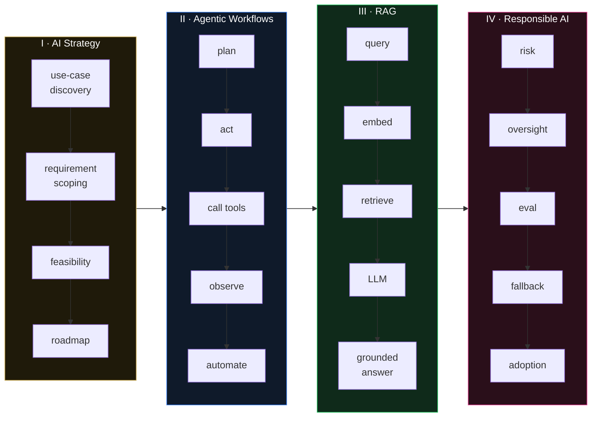

<!-- ╔══════════════════════════════════════════════════════════════════════════╗
     ║  ANISHA SINGLA · GitHub Profile README · v4 · portfolio-OS theme          ║
     ╚══════════════════════════════════════════════════════════════════════════╝ -->

<a name="top"></a>

<div align="center">


[](https://git.io/typing-svg)

<br/>

<!-- ─────────────── NAV ─────────────── -->

[](#01--about)
[](#02--products-in-production)
[](#03--capabilities)
[](#04--experience)
[](#05--writing--speaking)
[](#06--education--certifications)
[](#07--applied-ml-lab)
[](#08--contact)

<br/>

<!-- ─────────────── HERO STATS ─────────────── -->

<table>
<tr>
<td align="center" width="25%"><h2>3</h2><sub>AI products<br/>in production</sub></td>
<td align="center" width="25%"><h2>10</h2><sub>clients delivered<br/>3 verticals</sub></td>
<td align="center" width="25%"><h2>100%</h2><sub>on-time<br/>delivery</sub></td>
<td align="center" width="25%"><h2>20+ h</h2><sub>manual work saved<br/>per client / week</sub></td>
</tr>
</table>


</div>

<br/>

---

## 01 · About

```python
class AnishaSingla:
    """I build AI systems that survive contact with production."""

    role      = "AI Business Analyst · GenAI adoption, requirements & delivery"
    location  = "Toronto, ON 🇨🇦"
    now       = ["AI-Powered Digital Marketing Consultant @ APT Growth Digital",
                 "Executive Program — Generative AI & Organizational Transformation @ Rotman"]
    founded   = "Teeny Tech Trek (Sep 2024) — AI solutions studio, now run by its team lead"

    def what_i_do(self) -> list[str]:
        return ["AI use-case discovery & scoping", "RAG & agent workflow design",
                "Requirements → specs → acceptance", "Responsible AI & governance",
                "Design-thinking facilitation"]
```

<table>
<tr>
<td width="60%" valign="top">

Two years turning AI pilots into working systems for real businesses — production RAG chatbots, AI agents and workflow automations for **10 clients across Real Estate, Immigration and Education**. I owned requirements, architecture, delivery and client success end to end on every engagement.

In parallel I led digital transformation at a precision-engineering manufacturer, where the factory floor became a proving ground for the same n8n + LLM automations I shipped to clients.

George Brown Polytechnic: Applied AI Solutions Development + Project Management, **Dean's Honour List in all four terms**. Now at **Rotman (U of T)** studying Generative AI and Organizational Transformation.

</td>
<td width="40%" valign="top">

```
┌─ anisha@portfolio ─────────────────┐
│ $ cat status.txt                   │
│                                    │
│  ▸ based      Toronto, Canada      │
│  ▸ work auth  PGWP · full-time     │
│  ▸ seeking    AI BA · Strategy ·   │
│               AI Consulting        │
│  ▸ languages  EN · HI              │
│  ▸ founder    Teeny Tech Trek      │
│                                    │
│ $ ▋                                │
└────────────────────────────────────┘
```

</td>
</tr>
</table>

<div align="center">

[](https://www.linkedin.com/in/singlaanisha)
[](https://www.anishasingla.com/)
[](https://medium.com/@teenytechtrek)
[](https://www.anishasingla.com/resume.pdf)
[](mailto:anishasingla23@gmail.com)

</div>

<p align="right"><a href="#top">⬆ back to top</a></p>

---

## 02 · Products in Production

> **The Tech Trekkers Suite** — three AI agent products on one shared agentic engine. I set product strategy for each: target users, pricing (tiers · credits · BYOK) and model selection.

<table>
<tr>
<td width="50%" valign="top">

### 🏠 Nex-Estate &nbsp; 
**Real Estate AI Avatar Platform · 2025**

Agents deploy a personalised AI avatar via QR code. Buyers scan, chat, get property recommendations and book visits — 24/7. Lead scoring, CRM pipeline, team management, Razorpay billing.

`React` `TypeScript` `Node.js` `MongoDB` `AWS` `Razorpay`

[](https://www.anishasingla.com/case-studies/real-estate-intelligence-dashboard+rag-business-knowledge-assistant)
[](https://github.com/Teeny-Tech-Trek/nex-estate-frontend)

</td>
<td width="50%" valign="top">

### 🤝 NetTwin &nbsp; 
**Conversational Digital Twin · 2025**

Turns a professional's resume + website into an always-on assistant that answers visitors' questions and captures and qualifies leads round the clock.

`React` `TypeScript` `Node.js` `LLM` `RAG` `AWS`

[](https://www.anishasingla.com/case-studies/conversational-digital-twin-platform)
[](https://github.com/Teeny-Tech-Trek/nettwin-frontend)

</td>
</tr>
<tr>
<td width="50%" valign="top">

### ✍️ NeoScript &nbsp; 
**Generative AI Multi-Agent System · 2025**

An MCP server. Plug it into Claude Desktop, Cursor or Windsurf and a ten-agent pipeline drafts trusted, citation-backed content directly inside your conversation.

`Python` `FastAPI` `React` `Gemini` `Qdrant` `Docker` `Vercel` `Railway`

[](https://www.anishasingla.com/case-studies/multi-agent-content-intelligence-system)
[](https://github.com/Teeny-Tech-Trek/neo-scripting-frontend)

</td>
<td width="50%" valign="top">

### 🤖 TTT Website Chatbot &nbsp; 
**Hybrid RAG Chatbot · 2024**

4-layer decision waterfall — Redis cache → guided flow → structured handler → RAG (FAISS + Neo4j + Claude). The easy 80% of queries never hit the LLM.

`FastAPI` `Claude` `FAISS` `Neo4j` `Redis` `MongoDB` `spaCy`

[](https://www.anishasingla.com/case-studies/rag-business-knowledge-assistant)
[](https://github.com/Teeny-Tech-Trek/ttt_website_frontend)

</td>
</tr>
</table>

<details>
<summary><b>🌐 Also shipped — Teeny Tech Trek company website</b> · React 18 · TypeScript · Tailwind · mobile-first, SEO + a11y focused</summary>
<br/>

[](https://www.anishasingla.com/case-studies/responsible-ai-governance-framework+rag-business-knowledge-assistant)
[](https://github.com/Teeny-Tech-Trek/ttt_website_frontend)
[](https://www.teenytechtrek.com/)

</details>

<p align="right"><a href="#top">⬆ back to top</a></p>

---

## 03 · Capabilities



<details open>
<summary><b>I · AI Strategy & Use-Case Discovery</b> — where AI actually creates value</summary>
<br/>Identifying workflows where AI creates measurable value, scoping requirements, prioritising practical implementation paths.<br/><br/>

`Use-case discovery` `Requirement scoping` `Feasibility` `Roadmapping`
</details>

<details>
<summary><b>II · Agentic Workflows & Automation</b> — beyond demos, into production</summary>
<br/>Designing AI agents, tool-using workflows and automation systems that move from prototype into real business processes.<br/><br/>

`AI agents` `Tool use` `Orchestration` `Automation` · Python · FastAPI · Claude · LangChain · n8n
</details>

<details>
<summary><b>III · RAG & Knowledge Assistants</b> — answers grounded in your knowledge</summary>
<br/>Retrieval-based assistants that answer from business documents, websites, FAQs and internal knowledge.<br/><br/>

`RAG` `Vector search` `Embeddings` `Knowledge bases` · FAISS · Qdrant · Neo4j
</details>

<details>
<summary><b>IV · Responsible AI & Governance</b> — AI you can actually trust</summary>
<br/>Risk, human oversight, evaluation, fallback paths and adoption readiness for AI systems.<br/><br/>

`Risk & guardrails` `Human oversight` `Evaluation` `Adoption readiness`
</details>

<details>
<summary><b>V · Design Thinking & Stakeholder Leadership</b> — human-centred, stakeholder-aligned</summary>
<br/>Certified Design Thinking practitioner. Translating complex requirements into clear architecture, stakeholder alignment and agile delivery.<br/><br/>

`Design thinking` `Facilitation` `Stakeholder leadership` `Agile delivery`
</details>

<br/>

```bash
anisha@portfolio:~$ ls ~/skills

├─ ai-ml/              ML Algorithms · RAG · FAISS · Neo4j · Qdrant · Gemini · Claude
├─ languages/          Python · SQL · C/C++ · TypeScript
├─ frontend/           React · Tailwind · Vite · React Router
├─ backend/            FastAPI · Node.js · MongoDB · Redis
├─ strategy-analysis/  Business Analysis · AI Strategy · Requirements · Change Mgmt · Product Mgmt
├─ leadership/         Team leadership · Agile/Scrum · Mentoring · Design thinking
└─ tools/              n8n · Jira · ClickUp · Excel · ChatGPT · Claude · Gemini · Perplexity
```

<div align="center">

[](.)

</div>

<p align="right"><a href="#top">⬆ back to top</a></p>

---

## 04 · Experience

```
2026 ──●  AI-Powered Digital Marketing Consultant   APT Growth Digital Inc.      Sep 2026 →  Toronto
       │
2024 ──●  Founder & AI Solutions Consultant         Teeny Tech Trek              Sep 2024 → Oct 2026
       ●  Project Manager                           Appu International           Jun 2024 → Aug 2026
       │
2023 ──●  Support Advisor                           startGBC · George Brown      Sep → Dec 2023
       ●  Entrepreneur Trainee                      startGBC · George Brown      May → Aug 2023
       │
2021 ──●  IT Implementation & Coordination Spec.    Appu International           Sep 2021 → Jul 2022
       ●  Frontend Developer (Intern)               CETPA Infotech               Feb → Jul 2021
```

<details>
<summary><b>APT Growth Digital Inc.</b> — AI-Powered Digital Marketing Consultant · Sep 2026 – Present · Toronto</summary>
<br/>

- Delivered an **AEO / GEO visibility audit** — tested brand citations across ChatGPT, Gemini and Perplexity; recommended page-level and content-gap changes
- Produce AI-enabled marketing research and strategy documents for internal teams and client accounts
</details>

<details>
<summary><b>Teeny Tech Trek</b> — Founder & AI Solutions Consultant · Sep 2024 – Oct 2026 · Remote</summary>
<br/>

- Founded and led an AI solutions studio delivering production RAG chatbots, AI agents and workflow automation for **10 clients** across real estate, immigration and education — **100% on-time**
- Led every engagement from first requirement to release — scope, delivery, client success — directing contractors and developers on each
- Designed agentic workflows and automations (n8n, APIs, LLM orchestration) that **cut client manual effort by ~20 hours/week**
- Established Responsible AI practices — data privacy, evaluation, guardrails, human-in-the-loop — across every deployment
- Handed day-to-day leadership to the team lead in Oct 2026; the studio continues under its team
</details>

<details>
<summary><b>Appu International</b> — Project Manager · Jun 2024 – Aug 2026 · Ludhiana (Hybrid)</summary>
<br/>

- Headed an internal R&D initiative to automate manufacturing and business processes — **5 automations** (quotation, order tracking, production reporting, inventory alerts) on n8n + LLM tools, saving **10 hours/week**
- Piloted Industry 4.0 upgrades — sensor-based monitoring and finished-product testing — cutting downtime by 3%
- Managed international client relationships across 3 markets — RFQ to after-sales — at 90% on-time delivery
- Managed **Solvoka**, the company's precision-steel export brand; opened 2 new automotive-aftermarket accounts
</details>

<details>
<summary><b>startGBC, George Brown</b> — Support Advisor · Entrepreneur Trainee · 2023 · Toronto</summary>
<br/>

- Designed the Entrepreneurship Club powered by startGBC — mission, weekly programming model, constitution and governance for a self-sustaining student-led operation; the club launched and still runs
- Validated a business concept through 10 customer interviews and market analysis, then advised other founders
</details>

<details>
<summary><b>Appu International</b> — IT Implementation & Coordination Specialist · Sep 2021 – Jul 2022</summary>
<br/>

- Introduced inventory, digital quotation and order-tracking systems into a paper-based manufacturer across 2 departments
- Gathered requirements from production, sales and accounts; coordinated vendors through setup, testing and go-live
- Trained non-technical staff and authored SOPs — adoption from 10% to 40% in 3 months
</details>

<details>
<summary><b>CETPA Infotech</b> — Frontend Developer (Internship) · Feb – Jul 2021 · Remote</summary>
<br/>

- Built a COVID-19 tracker dashboard in React.js on live public-health REST APIs — Chart.js visualisations, search, filtering, responsive layout, sub-0.5s initial load
</details>

<p align="right"><a href="#top">⬆ back to top</a></p>

---

## 05 · Writing & Speaking

<table>
<tr>
<td width="50%" valign="top">

### ✍️ LinkedIn Technical Series

- [MCP Tool "Rug Pull"](https://www.linkedin.com/posts/singlaanisha_aiarchitecture-enterpriseai-aiagents-ugcPost-7485282125529759744-0tqi/)
- [The "Lethal Trifecta"](https://www.linkedin.com/posts/singlaanisha_aiengineering-productionai-aiagents-ugcPost-7485281736856117248-H3P6/)
- [RAG for Business](https://www.linkedin.com/posts/singlaanisha_rag-aiforbusiness-llm-ugcPost-7485281372312469504-e3QP/)
- [Production AI & Engineering](https://www.linkedin.com/posts/singlaanisha_rag-aiengineering-productionai-ugcPost-7485280404220837888-LVXE/)
- [AI Agents in Practice](https://www.linkedin.com/posts/singlaanisha_rag-aiengineering-aiagents-ugcPost-7483480527241441280-y72a/)

[](https://medium.com/@teenytechtrek)

</td>
<td width="50%" valign="top">

### 🎤 Speaking

| Event | |
|:---|:---|
| **"Five Questions Before AI Adoption"** — AiNetworking-Canada · Nov 2026 | Speaker |
| **"Unlock AI"** — workshop for business owners | Facilitator |
| **TiECon Chandigarh 2026** | Product demos |
| [**TiE Chandigarh — Open Mic**](https://www.linkedin.com/posts/tie-chandigarh_open-mic-session-tie-chandigarh-ugcPost-7463546856598364161-MmHB) | Speaker |
| [**Podcast appearance**](https://youtu.be/MWCYy_OmrWs) · Apr 2026 | Guest |

</td>
</tr>
</table>

<p align="right"><a href="#top">⬆ back to top</a></p>

---

## 06 · Education & Certifications

<div align="center">

| | Credential | Institution | |
|:---:|:---|:---|:---|
| 🔵 | **Executive Program — Generative AI & Organizational Transformation** | Rotman School of Management, U of T | Oct 2026 → *in progress* |
| 🏅 | **Graduate Certificate — Project Management** | George Brown Polytechnic | 2023–24 · Dean's Honour List |
| 🏅 | **Graduate Certificate — Applied AI Solutions Development** | George Brown Polytechnic | 2022–23 · Dean's Honour List |
| 🎓 | **B.Tech — Computer Engineering** | CGC Jhanjeri, Mohali | 2017–21 |


</div>

<details>
<summary><b>📜 Certifications</b> — click to verify</summary>
<br/>

| Certification | Issuer | |
|:---|:---|:---:|
| AI Fluency: Framework & Foundations | Anthropic | [](https://verify.skilljar.com/c/q5h47icxibjv) |
| Responsible AI, Safety & Governance | Securiti AI | [](https://education.securiti.ai/verification/1450DE4DA-1450DE349-13EDC0BE2/) |
| Design Thinking Practitioner | IBM · Credly | [](https://www.credly.com/badges/36bad26a-2dab-4185-a5a9-099c6d8ca3b2) |
| Python | Coursera | [](https://www.coursera.org/account/accomplishments/certificate/NK42FS6AWLUE) |

</details>

<details>
<summary><b>🌐 Community & Leadership</b></summary>
<br/>

| Role | Organisation | |
|:---|:---|:---|
| Charter Member | TiE Chandigarh | May 2026 → |
| Community Coordinator | Connect Circles: Chandigarh | Mar – Jun 2026 |
| President, AI Club | George Brown Polytechnic | Oct 2023 – Apr 2024 |
| VP, AI Club | George Brown Polytechnic | Nov 2022 – Oct 2023 |
| Event Manager | CGC Jhanjeri | 2018 – 2020 |

</details>

<p align="right"><a href="#top">⬆ back to top</a></p>

---

## 07 · Applied ML Lab

<details>
<summary><b>Click to expand</b> — deep learning, NLP and ML work from George Brown and beyond</summary>
<br/>

| | Project | What it is | Stack | |
|:---:|:---|:---|:---|:---:|
| 🖼️ | **Transfer Learning Image Classifier** | Xception two-phase fine-tune on tf_flowers + cars196 — **91%+ val acc** on 3,670 images | TensorFlow · Keras · Colab | [](https://github.com/Anisha-Singla-22/TransferLearning) [](https://www.anishasingla.com/case-studies/transfer-learning-image-classification) |
| 🔍 | **Jigsaw Toxic Comment Classifier** | 6-label classifier on 159K Wikipedia comments — TF-IDF + repeat-word ablation — **0.96963** private LB | scikit-learn · NLTK · Kaggle | [](https://github.com/Anisha-Singla-22/Jigsaw) |
| 📊 | **Flipkart Sentiment Analyzer** | 1–5 star prediction on 169K reviews — GloVe + LR (81.4%) and LSTM (~90%+) | TensorFlow · GloVe · NLTK | [](https://github.com/Anisha-Singla-22/SentimentalAnalysis) |
| 🎭 | **ShakeGen** | Character-level GRU language model on 1.1M chars of Shakespeare — temperature sampling | TensorFlow · Keras · GRU | [](https://github.com/Anisha-Singla-22/Shakegen) [](https://www.anishasingla.com/case-studies/shakegen-character-level-language-model) |
| 📚 | **ML & NLP Suite** | 7 notebooks — classification, LDA, CRF NER, recommenders, summarisation, segmentation, real-time video | scikit-learn · Gensim · spaCy · OpenCV | [](https://github.com/Anisha-Singla-22/ML-NLP-suite) |

<div align="center">

[](https://www.anishasingla.com/projects)

</div>

</details>

<details>
<summary><b>📊 GitHub activity</b></summary>
<br/>

<div align="center">

<picture>
  <source media="(prefers-color-scheme: dark)" srcset="https://github-readme-stats.vercel.app/api?username=Anisha-Singla-22&show_icons=true&theme=tokyonight&hide_border=true&include_all_commits=true&count_private=true&title_color=C9A84C&icon_color=C9A84C"/>
  
</picture>
<picture>
  <source media="(prefers-color-scheme: dark)" srcset="https://streak-stats.demolab.com/?user=Anisha-Singla-22&theme=tokyonight&hide_border=true&ring=C9A84C&fire=C9A84C"/>
  
</picture>


> Most production code lives under the [**Teeny-Tech-Trek**](https://github.com/Teeny-Tech-Trek) organisation.

</div>

</details>

<p align="right"><a href="#top">⬆ back to top</a></p>

---

## 08 · Contact

<div align="center">

```
anisha@portfolio:~$ ./connect --role "AI Business Analyst" --city Toronto
```

[](mailto:anishasingla23@gmail.com)
[](https://www.linkedin.com/in/singlaanisha)
[](https://www.anishasingla.com/)
[](https://www.anishasingla.com/resume.pdf)

**Business:** `anishasingla@teenytechtrek.com` · [teenytechtrek.com](https://www.teenytechtrek.com/)


<br/>


**ANISHA.** · AI Business Analyst · Toronto, Canada

> *"I build AI systems that survive contact with production."*

</div>
